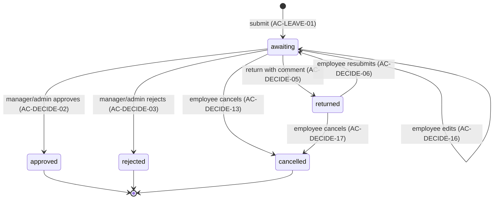
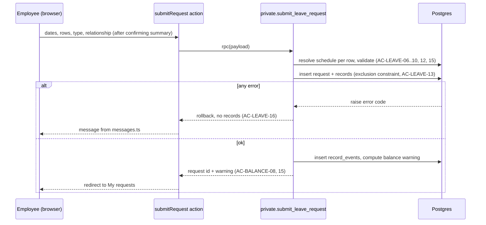

# Design Document

## Overview

This design implements slice WS6: submitting leave requests, managers' decisions and leave balances
(`requirements.md`, Requirements 1–11). It targets the course's developer project template
(`koldovsky/2026-quitcode-06-project-template`): Next.js 16 App Router, React 19, Supabase (Postgres, Auth, RLS) via
`@supabase/ssr`, Tailwind 4 and Vitest 5. All business rules that guard data (who may decide, overlaps, statuses,
balance split) are enforced in the database so they hold for direct API calls. Calculation rules that the UI also needs
for previews (minutes inside blocks, day shares, split suggestion) live in pure TypeScript functions that mirror the SQL
and share one test matrix.

## Steering Document Alignment

### Technical Standards

Follows the template's `AGENTS.md` and its first migration (`supabase/migrations/20261012000000_profiles_and_roles.sql`):

- RLS enabled on every `public` table; `revoke all from anon, authenticated`, then explicit grants per operation.
- One policy per operation, always `to authenticated`; `auth.uid()` only as `(select auth.uid())`.
- `security definer` functions only in schema `private`, with `set search_path = ''`.
- Migrations are timestamped `YYYYMMDDHHMMSS_name.sql`, newer than the last one on `main`
  (`scripts/check-migration-order.mjs`).
- Every test title contains the AC ID it covers (`scripts/check-ac-coverage.mjs`), and `docs/conformance.md` has one
  row per AC.

### Project Structure

```
supabase/migrations/   SQL: tables, constraints, RLS, RPC functions
supabase/seed.sql      test data: divisions, positions, schedules, managers, carry-over
src/lib/leave/         pure domain functions (no I/O) + error-code → message map
src/lib/supabase/      existing clients (server.ts, client.ts, proxy.ts)
src/app/(app)/...      pages and server actions per screen
tests/leave/           unit tests for pure functions
tests/db/              integration tests against local Supabase (RLS, RPC, constraints)
```

## Code Reuse Analysis

### Existing Components to Leverage

- **`public.profiles` + `private.current_app_role()`**: identity and app role. Extended to roles
  `employee | manager | admin` following the recipe in the migration header (data → default → constraint).
- **`src/lib/supabase/server.ts` `createClient()`**: every server action and server component uses it, so RLS applies
  with the signed-in user's JWT.
- **`src/proxy.ts` / `src/lib/supabase/proxy.ts`**: session refresh and redirect to `/login` for every page.
- **`src/app/login`**: sign-in; no changes.
- **`scripts/create-demo-users.mjs` + `supabase/demo-users.json`**: create teacher1/teacher2/manager1/manager2/admin
  `@example.test` users used by the ACs.
- **`database.types.ts` (`npm run db:types`)**: typed RPC calls and rows.

### Integration Points

- **Supabase Auth**: `auth.uid()` identifies the actor in RLS and RPC functions.
- **Postgres**: new tables reference `public.profiles(id)`; overlaps are prevented by an exclusion constraint
  (`btree_gist`).

## Architecture

Server-rendered pages read through RLS-protected views; every write goes through one `security definer` RPC per
action. RPCs re-check permissions explicitly (they bypass RLS), lock the affected rows, validate, write the change and
an event row in one transaction.

### Modular Design Principles

- **Single File Responsibility:** one file per domain concern (`schedule.ts`, `duration.ts`, `balance.ts`,
  `messages.ts`) and one `actions.ts` per screen.
- **Component Isolation:** small client components (date picker, position row, summary dialog) receive data via props.
- **Service Layer Separation:** UI → server action → RPC; pages never write tables directly.
- **Utility Modularity:** pure functions are imported by both UI previews and tests; SQL mirrors them.

```mermaid
graph TD
    UI[Pages and client components<br/>src/app/(app)/*] --> SA[Server actions<br/>actions.ts]
    UI --> DOM[Pure domain functions<br/>src/lib/leave/*]
    SA --> DOM
    SA --> SB[Supabase server client<br/>src/lib/supabase/server.ts]
    SB --> RPC[RPC functions<br/>private.* via public wrappers]
    SB --> V[RLS views<br/>my_records, manager_queue, balances]
    RPC --> T[(Tables + exclusion constraint)]
    V --> T
    RPC --> EV[(record_events)]
```

### Record status lifecycle



### Submit request sequence



## Components and Interfaces

### Component 1 — Schedule resolution (`src/lib/leave/schedule.ts`, SQL `private.position_blocks`)

- **Purpose:** blocks of a position on a date; validate an interval; minutes inside blocks.
- **Interfaces:** `blocksFor(schedule, date): Block[]`; `validateInterval(blocks, start, end): ErrorCode | null`
  (AC-LEAVE-07, -08, -09); `minutesInBlocks(blocks, start, end): number` (AC-LEAVE-04, -15).
- **Dependencies:** none (pure). SQL twin uses `schedule_blocks`.
- **Reuses:** nothing existing.

### Component 2 — Duration and balance math (`src/lib/leave/duration.ts`, `balance.ts`)

- **Purpose:** day share, school year, carry-over, over-balance split.
- **Interfaces:** `dayShare(recordMinutes, dayTotalMinutes): number` rounded half up to 2 dp (AC-BALANCE-03, -06);
  `schoolYearOf(date): number` (1 Sep–31 Aug); `suggestSplit(requestedDays, remaining): {paid, unpaid}`
  (AC-BALANCE-08, -09, -15).
- **Dependencies:** none.
- **Reuses:** nothing existing.

### Component 3 — Messages (`src/lib/leave/messages.ts`)

- **Purpose:** map RPC error codes (`LEAVE_NO_HOURS`, `LEAVE_OUTSIDE_SCHEDULE`, `LEAVE_START_AT_BLOCK_END`,
  `LEAVE_END_BEFORE_START`, `LEAVE_NO_POSITION`, `LEAVE_RELATIONSHIP_REQUIRED`, `LEAVE_OVERLAP`,
  `DECIDE_COMMENT_REQUIRED`, `DECIDE_ALREADY_DECIDED`, `DECIDE_OWN_RECORD`, `DECIDE_FORBIDDEN`, `RECORD_LOCKED`,
  `BALANCE_SPLIT_REQUIRED`) with parameters to the exact AC texts.
- **Interfaces:** `messageFor(code, params): string`.

### Component 4 — Submit request (`src/app/(app)/requests/new/`)

- **Purpose:** date selection, per-position rows (include, whole day / hours), leave type, relationship, summary dialog
  (AC-LEAVE-11), submit.
- **Interfaces:** server action `submitRequest(input)` → `{ ok, requestId, warning } | { ok: false, message }`;
  RPC `submit_leave_request(payload jsonb)`.
- **Dependencies:** Components 1–3, Supabase server client.

### Component 5 — My requests (`src/app/(app)/requests/`)

- **Purpose:** own records with status and manager comment (AC-LEAVE-14, AC-DECIDE-03, -05); edit, resubmit, cancel
  (AC-DECIDE-06, -12, -13, -16, -17).
- **Interfaces:** view `my_records`; actions `updateOwnRecord`, `resubmitRecord`, `cancelOwnRecord` → RPCs of the same
  names.

### Component 6 — Manager workspace (`src/app/(app)/manager/`, `src/app/(app)/records/[id]/`)

- **Purpose:** "Awaiting decision" and "History" tabs (AC-DECIDE-01, -11, -14); record card with warnings, split
  suggestion and history (AC-BALANCE-09, -14, AC-DECIDE-15); decide.
- **Interfaces:** view `manager_queue`; action `decideRecord(recordId, decision, comment?, acceptSplit?)` → RPC
  `decide_record`.
- **Rules inside `decide_record`:** actor is admin, or a responsible manager of the record's position and not the
  record's employee (AC-DECIDE-08, -09, -18, -19); `select … for update` on the record and require status `awaiting`
  (AC-DECIDE-07); comment required for `return` (AC-DECIDE-04); for paid types, recompute remaining at this moment and
  require `acceptSplit` when it is exceeded (AC-BALANCE-14, -16); on approve store `paid_days` / `unpaid_days`
  snapshot (AC-BALANCE-10).

### Component 7 — Balances (`src/app/(app)/balances/`, view `leave_balances`)

- **Purpose:** granted, carried over, used, remaining per type and school year (AC-BALANCE-01..07, -11); visibility per
  role (AC-BALANCE-12, -13).
- **Interfaces:** view `leave_balances(employee_id, school_year, leave_type, granted, carried_over, used, remaining)`;
  RLS-filtered via `private.can_see_employee(employee_id)`.

## Data Models

```
profiles (existing)         id uuid PK → auth.users, email, full_name, role text check in (employee, manager, admin)
divisions                   id uuid PK, name text unique
positions                   id uuid PK, employee_id uuid → profiles, kind text check in (main, additional),
                            division_id → divisions, title text, active_from date, active_to date null
                            unique (employee_id) where kind = 'main'
position_managers           position_id → positions, manager_id → profiles, PK (position_id, manager_id)
schedule_blocks             id, position_id → positions, weekday smallint 1..7, start_time time, end_time time,
                            effective_from date, effective_to date null, check (end_time > start_time)
leave_types                 code text PK (sick, personal, unpaid, family), name text, is_paid bool,
                            annual_limit numeric(5,2) null  -- 18.00, 18.00, null, null
balance_carryovers          employee_id, leave_type → leave_types, school_year int, days numeric(5,2),
                            PK (employee_id, leave_type, school_year)
leave_requests              id uuid PK, employee_id → profiles, created_by → profiles, leave_type → leave_types,
                            relationship text null check in (sibling, child, parent, grandchild, grandparent),
                            created_at timestamptz
leave_records               id uuid PK, request_id → leave_requests, position_id → positions,
                            employee_id → profiles (denormalised for RLS), work_date date,
                            start_at timestamptz, end_at timestamptz, minutes int,
                            day_total_minutes int  -- employee's scheduled minutes that date (snapshot)
                            status text check in (awaiting, approved, rejected, returned, cancelled),
                            manager_comment text null, decided_by → profiles null, decided_at timestamptz null,
                            paid_days numeric(5,2) null, unpaid_days numeric(5,2) null
                            EXCLUDE USING gist (position_id WITH =, tstzrange(start_at, end_at) WITH &&)
                              WHERE (status IN ('awaiting', 'returned', 'approved'))
record_events               id bigserial, record_id → leave_records, actor_id → profiles, action text,
                            from_status text null, to_status text, comment text null, at timestamptz default now()
app_settings                key text PK, value text  -- time_zone = 'Europe/Kyiv'
```

Day-share rule (Requirement 9): for an approved record on date D, its share is
`round_half_up((approved minutes of the employee on D for this type incl. this record) / day_total_minutes, 2)` minus
the share already counted for D, capped so that D never exceeds 1.00. This keeps AC-BALANCE-05 at exactly 1.00
(0.85 + 0.15).

## Error Handling

1. **Invalid interval or date** (AC-LEAVE-06..10, -12)
   - **Handling:** pure validation in the form for instant feedback; the same checks repeated in
     `submit_leave_request`, which raises an error code.
   - **User Impact:** the exact AC message next to the row; nothing saved.
2. **Overlap with an existing record** (AC-LEAVE-13, -16)
   - **Handling:** the exclusion constraint violation (23P01) is caught in the RPC and re-raised as `LEAVE_OVERLAP` with
     the conflicting date and time; the transaction rolls back.
   - **User Impact:** "You already have a request for this time: …"; no record for any date.
3. **Concurrent decisions** (AC-DECIDE-07)
   - **Handling:** row lock plus a status check; the second caller gets `DECIDE_ALREADY_DECIDED` with the current status.
   - **User Impact:** "Another manager has already decided: Approved"; the card refreshes.
4. **Unauthorised decision or view** (AC-DECIDE-08, -09, -18, AC-BALANCE-12, -13)
   - **Handling:** the RPC raises `DECIDE_FORBIDDEN` / `DECIDE_OWN_RECORD`; views return no rows through RLS.
   - **User Impact:** the own-record message for AC-DECIDE-18; otherwise nothing changes and no data is shown.
5. **Balance exceeded at decision time** (AC-BALANCE-14, -16)
   - **Handling:** the RPC recomputes remaining under the lock; without `acceptSplit` it raises
     `BALANCE_SPLIT_REQUIRED`.
   - **User Impact:** the split warning; approval only with the split, or reject.
6. **Edit of a decided record** (AC-DECIDE-12)
   - **Handling:** `RECORD_LOCKED` when status is not `awaiting` / `returned`.
   - **User Impact:** "This record is already approved and cannot be changed".

## Testing Strategy

### Unit Testing

Vitest in `tests/leave/`: `schedule.test.ts`, `duration.test.ts`, `balance.test.ts`, `messages.test.ts`. One test per AC
whose rule is pure arithmetic or validation (AC-LEAVE-04, -06..-09, -15; AC-BALANCE-03, -05, -06, -08, -15, -11), with
the AC ID in the title, for example `it("AC-BALANCE-03: 150 of 420 minutes is 0.36 day")`.

### Integration Testing

Vitest in `tests/db/` against local Supabase (`supabase start`), signing in as the demo users:

- RPC behaviour and rollback (AC-LEAVE-01..05, -10, -12, -13, -16; AC-DECIDE-02..07, -10..-19);
- RLS for every role (AC-LEAVE-14, AC-DECIDE-01, -08, -09, AC-BALANCE-12, -13);
- balance views and split (AC-BALANCE-01, -02, -04, -07, -09, -10, -14, -16).

### End-to-End Testing

The template has no browser test runner. Add Playwright for the UI-only behaviours: the summary dialog not saving
(AC-LEAVE-11), the Saturday date being refused in the picker (AC-LEAVE-06), and one happy path per key workflow (submit
→ approve → balance). If adding Playwright is not allowed in the course, mark these ACs as manually verified in
`docs/conformance.md`.
