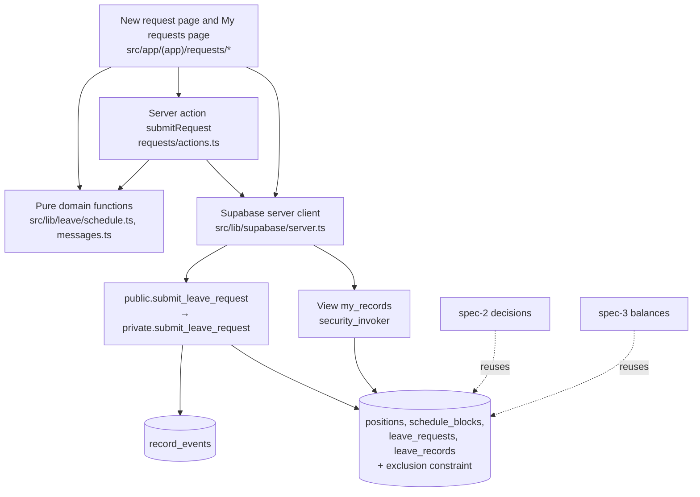
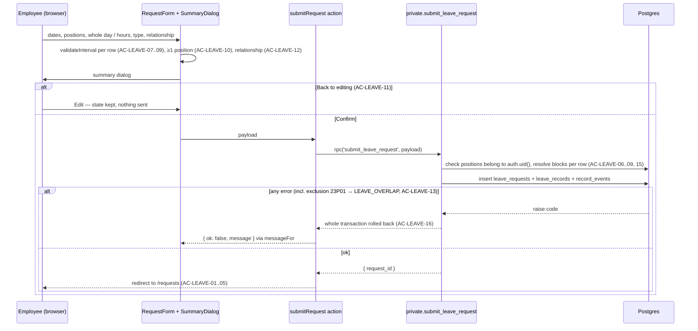
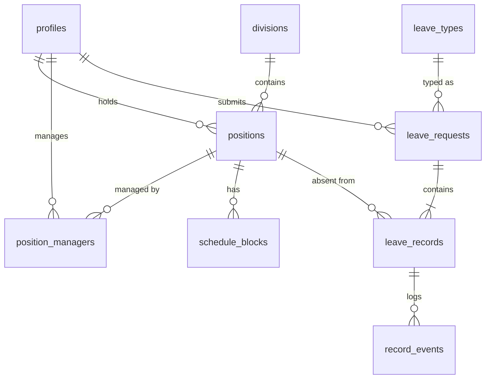

Spec 1 of 3 — leave request. Depends on: none. Used by: spec-2-leave-decision, spec-3-leave-balance.

# Design Document

## Overview

This design implements spec 1 of slice WS6: an employee submits a leave request and sees their own records
(`requirements.md`, Requirements 1–4, AC-LEAVE-01..16). It also creates the shared data foundation that
spec-2-leave-decision and spec-3-leave-balance build on: portal roles, divisions, positions, responsible managers,
schedules, leave types, requests, records, record events, the overlap constraint and the select RLS policies.

It targets the course's developer project template (`koldovsky/2026-quitcode-06-project-template`): Next.js 16 App
Router, React 19, Supabase (Postgres, Auth, RLS) via `@supabase/ssr`, Tailwind 4 and Vitest. Rules that guard data
(schedule fit, overlaps, ownership, all-or-nothing) are enforced in the database so they hold for direct API calls.
Working-hour rules that the form also needs for instant feedback (blocks of a date, interval validation, minutes inside
blocks) live in pure TypeScript functions that mirror the SQL and share one test matrix.

What other specs add on top (not designed here):

- **spec-2-leave-decision:** RPCs `decide_record`, `update_own_record`, `resubmit_record`, `cancel_own_record`; views
  `manager_queue`, `record_history`; `DECIDE_*` / `RECORD_*` message codes; edit/resubmit/cancel controls and the manager
  comment in "My requests"; the manager workspace.
- **spec-3-leave-balance:** columns `leave_records.paid_days` / `unpaid_days`, `leave_types.annual_limit`, table
  `balance_carryovers`, view `leave_balances`, `src/lib/leave/duration.ts` and `balance.ts`, `BALANCE_*` codes, and the
  over-balance warning returned by an extended `submit_leave_request`.

## Steering Document Alignment

### Technical Standards

Follows the template's `AGENTS.md` and its first migration (`supabase/migrations/20261012000000_profiles_and_roles.sql`):

- RLS enabled on every `public` table; `revoke all from anon, authenticated`, then explicit grants per operation.
- One policy per operation, always `to authenticated`; `auth.uid()` only as `(select auth.uid())`.
- `security definer` functions only in schema `private`, with `set search_path = ''`; `public` holds thin
  `security invoker` wrappers that the Data API exposes.
- Migrations are timestamped `YYYYMMDDHHMMSS_name.sql`, newer than the last one on `main`
  (`scripts/check-migration-order.mjs`); this spec uses `20261020090000`–`20261020090400`, and specs 2 and 3 continue
  after them.
- Every test title contains the AC ID it covers (`scripts/check-ac-coverage.mjs`), and `docs/conformance.md` has one
  row per AC.
- Repo is public: only synthetic names and `@example.test` emails in seed data.

### Project Structure

```
supabase/migrations/   SQL: roles, tables, constraint, RLS, submit RPC, my_records view
supabase/seed.sql      test divisions (no user-dependent rows)
scripts/               create-demo-users.mjs (existing) + seed-leave-demo.mjs (positions, managers, schedules)
src/lib/leave/         pure domain functions (no I/O) + error-code → message map
src/lib/supabase/      existing clients (server.ts, client.ts, proxy.ts)
src/app/(app)/requests/          "My requests" page + actions.ts
src/app/(app)/requests/new/      "New request" page, form and summary dialog
tests/leave/           unit tests for pure functions
tests/db/              integration tests against local Supabase (RLS, RPC, constraint)
tests/e2e/             Playwright tests for UI-only behaviour
```

## Code Reuse Analysis

### Existing Components to Leverage

- **`public.profiles` + `private.current_app_role()`**: identity and portal role. Extended from `member | admin` to
  `employee | manager | admin` following the recipe in the first migration's header (drop check → migrate data → set
  default → add check).
- **`src/lib/supabase/server.ts` `createClient()`**: every server action and server component uses it, so RLS applies
  with the signed-in user's JWT.
- **`src/proxy.ts` / `src/lib/supabase/proxy.ts`**: session refresh and redirect to `/login`; the new pages are behind
  it automatically.
- **`src/app/login`**: sign-in; unchanged.
- **`scripts/create-demo-users.mjs` + `supabase/demo-users.json`**: create teacher1, teacher2, manager1, manager2 and
  admin `@example.test` users used by the ACs.
- **`database.types.ts` (`npm run db:types`)**: typed RPC call and view rows.
- **`vitest.config.mts`**: test runner for unit and DB integration tests.

### Integration Points

- **Supabase Auth**: `auth.uid()` identifies the employee in RLS and in `submit_leave_request`.
- **Postgres**: new tables reference `public.profiles(id)`; overlaps are prevented by an exclusion constraint
  (`btree_gist`); time zone comes from `app_settings.time_zone`.
- **spec-2 / spec-3**: they reuse `private.is_manager_of`, the select policies, `record_events`, `messages.ts` and
  `my_records` (by `create or replace view` adding columns at the end).

## Architecture

Server-rendered pages read through RLS-protected views; the only write in this spec goes through one
`security definer` RPC. The RPC re-checks ownership explicitly (it bypasses RLS), validates every row, writes the request,
its records and their events in one transaction, and raises a stable error code on any failure, which rolls back the
whole request.

### Modular Design Principles

- **Single File Responsibility:** `schedule.ts` (working-hour rules), `messages.ts` (codes → texts), one `actions.ts`
  per screen, one migration per concern.
- **Component Isolation:** small client components (`RequestForm`, `PositionRow`, `SummaryDialog`) receive data via
  props; the page component loads schedules on the server.
- **Service Layer Separation:** UI → server action → RPC; pages never write tables directly.
- **Utility Modularity:** pure functions are imported by both the form and the tests; SQL mirrors them.



### Submit request sequence



### Data model (foundation shared with specs 2 and 3)



## Components and Interfaces

### Component 1 — Roles migration (`20261020090000_app_roles.sql`)

- **Purpose:** portal roles `employee | manager | admin` on `public.profiles.role`.
- **Interfaces:** `private.current_app_role()` (existing) now returns one of the three values.
- **Dependencies:** existing `profiles` migration.
- **Reuses:** the 3-step recipe in the header of `20261012000000_profiles_and_roles.sql`. The `manager` role controls
  navigation only; which records a manager may see is decided by `position_managers` (spec-2 enforces decisions).

### Component 2 — Organisation and schedule tables (`20261020090100_positions_and_schedules.sql`)

- **Purpose:** divisions, positions, responsible managers, weekly schedule blocks, app settings.
- **Interfaces:** tables in Data Models; helpers `private.is_manager_of(p_position_id uuid) returns boolean`
  (security definer, stable; true when `(select auth.uid())` is in `position_managers` for that position) and
  `private.is_admin() returns boolean`. Select policies:
  - `divisions`, `app_settings`: any authenticated user.
  - `positions`: `employee_id = (select auth.uid()) or private.is_manager_of(id) or private.is_admin()`.
  - `position_managers`: `manager_id = (select auth.uid())` or the position is visible (subquery on `positions`, which
    uses the definer helper, so no policy recursion) or admin.
  - `schedule_blocks`: the position is visible (subquery on `positions`).
  - No insert/update/delete grants to `authenticated` (managed by WS10; test data via seed script).
- **Dependencies:** Component 1.
- **Reuses:** RLS conventions of the first migration.

### Component 3 — Leave tables, constraint and events (`20261020090200_leave_records.sql`)

- **Purpose:** leave types, requests, records with overlap protection, record events.
- **Interfaces:** `create extension if not exists btree_gist`; partial exclusion constraint
  `leave_records_no_overlap` (see Data Models); `leave_types` seeded with `sick`, `personal`, `unpaid`, `family`;
  select policies:
  - `leave_types`: any authenticated user.
  - `leave_records`: `employee_id = (select auth.uid()) or private.is_manager_of(position_id) or private.is_admin()`.
  - `leave_requests`: own, or admin, or `exists` a visible record of the request.
  - `record_events`: the record is visible.
  - No insert/update/delete grants to `authenticated`; writes only through RPCs.
- **Dependencies:** Component 2.
- **Reuses:** —

### Component 4 — Schedule rules (`src/lib/leave/schedule.ts`, SQL twin in Component 6)

- **Purpose:** blocks of a position on a date; validate an interval; minutes inside blocks.
- **Interfaces:**
  - `type Block = { start: string; end: string }` (`"HH:MM"`, Kyiv wall clock)
  - `type ScheduleBlock = Block & { weekday: 1..7; effectiveFrom: string; effectiveTo: string | null }`
  - `blocksFor(schedule: ScheduleBlock[], date: string): Block[]` — sorted; empty → no working hours (AC-LEAVE-06)
  - `wholeDay(blocks): { start, end, minutes }` (BR-4)
  - `validateInterval(blocks, start, end): { code: LeaveErrorCode; params } | null` — order of checks:
    end ≤ start → `LEAVE_END_BEFORE_START` (AC-LEAVE-09); start equals a block end and lies in no block →
    `LEAVE_START_AT_BLOCK_END` (AC-LEAVE-08); start or end outside every block (end may equal a block end) or off the
    5-minute grid → `LEAVE_OUTSIDE_SCHEDULE` with the date's blocks joined by ", " (AC-LEAVE-07, BR-2, BR-3, BR-5)
  - `minutesInBlocks(blocks, start, end): number` (AC-LEAVE-04 = 150, AC-LEAVE-15 = 90)
  - `formatDuration(minutes): string` → `"2 h 30 min"`
- **Dependencies:** none (pure).
- **Reuses:** nothing existing.

### Component 5 — Messages (`src/lib/leave/messages.ts`)

- **Purpose:** map RPC and form error codes to the exact AC texts. Spec 1 owns only `LEAVE_*`; specs 2 and 3 add
  `DECIDE_*`, `RECORD_*` and `BALANCE_*` entries to the same map.
- **Interfaces:** `type LeaveErrorCode`; `messageFor(code: string, params?: Record<string, string>): string`;
  `parseRpcError(error: PostgrestError): { code, params }` (code from `error.message`, params from JSON in
  `error.details`).

| Code | Params | Message |
|---|---|---|
| `LEAVE_NO_HOURS` | — | You have no working hours on this day |
| `LEAVE_OUTSIDE_SCHEDULE` | `blocks` | Hours must be within your schedule: {blocks} |
| `LEAVE_START_AT_BLOCK_END` | `time` | {time} is the end of working time and can only be chosen as the end of leave |
| `LEAVE_END_BEFORE_START` | — | The end must be later than the start |
| `LEAVE_NO_POSITION` | — | Choose at least one position |
| `LEAVE_RELATIONSHIP_REQUIRED` | — | State your relationship to this person: sibling, child, parent, grandchild or grandparent. Not applicable to cousins, friends, neighbours or siblings-in-law |
| `LEAVE_OVERLAP` | `date`, `start`, `end` | You already have a request for this time: {date} {start}–{end} |
| `LEAVE_INVALID_INPUT` | — | The request could not be saved. Check the form and try again. |

Unknown codes fall back to `LEAVE_INVALID_INPUT`'s text and are logged with `console.error` on the server.

### Component 6 — Submit RPC (`20261020090300_rpc_submit.sql`)

- **Purpose:** the only write path for new leave; safe for direct API calls.
- **Interfaces:** `public.submit_leave_request(payload jsonb) returns jsonb` (security invoker wrapper, granted to
  `authenticated`) → `private.submit_leave_request(payload jsonb)` (security definer). Payload:

```json
{
  "leave_type": "personal",
  "relationship": null,
  "dates": ["2026-11-02", "2026-11-03"],
  "rows": [
    { "work_date": "2026-11-02", "position_id": "uuid", "whole_day": false, "start": "09:00", "end": "11:30" }
  ]
}
```

  Returns `{ "request_id": "uuid", "record_ids": ["uuid", …] }`. spec-3 extends the return value with a `warning`
  object without changing the payload.
- **Steps:** (1) `employee_id := (select auth.uid())`, null → `LEAVE_INVALID_INPUT`; (2) leave type exists, one per
  request (BR-8); `family` requires a valid relationship → `LEAVE_RELATIONSHIP_REQUIRED`; (3) every date in `dates` has
  ≥ 1 row → `LEAVE_NO_POSITION`; (4) every row's position belongs to `employee_id` and is active on the date →
  `LEAVE_INVALID_INPUT` (BR-11); (5) resolve blocks via `private.position_blocks(position_id, work_date)`; none →
  `LEAVE_NO_HOURS`; (6) whole day → first block start to last block end, otherwise validate as Component 4;
  (7) `minutes` = minutes inside blocks; `day_total_minutes` = all blocks of all the employee's active positions on that
  date; (8) `start_at`/`end_at` = `(work_date + time) at time zone app_settings.time_zone`; (9) insert request, records
  with status `awaiting`, one `record_events` row per record (`action = 'submit'`, `to_status = 'awaiting'`);
  (10) catch `exclusion_violation` (23P01), look up the conflicting active record of that position, and re-raise
  `LEAVE_OVERLAP` with its Kyiv date and times. Errors are raised as
  `raise exception using message = '<CODE>', detail = '<json params>'`, so the whole transaction rolls back (BR-7).
- **Dependencies:** Components 2–3; mirrors Component 4.
- **Reuses:** `private.current_app_role()` is not needed: every role submits only for itself.

### Component 7 — `my_records` view (`20261020090400_view_my_records.sql`)

- **Purpose:** the signed-in user's own records for "My requests".
- **Interfaces:** `public.my_records` with `security_invoker = true` and an explicit
  `where r.employee_id = (select auth.uid())` (managers and admins can see more rows through RLS, but "My requests"
  must show only their own — AC-LEAVE-14). Columns: `record_id, request_id, work_date, start_time, end_time` (Kyiv
  `HH:MM`), `minutes, position_id, position_label` ("Division / Title"), `leave_type, leave_type_name, relationship,
  status, manager_comment, created_at`. `manager_comment` is exposed now so spec-2 can show it without changing the
  view's shape.
- **Dependencies:** Components 2–3.

### Component 8 — Submit action (`src/app/(app)/requests/actions.ts`)

- **Purpose:** call the RPC from the server with the user's session.
- **Interfaces:** `submitRequest(input: SubmitRequestInput): Promise<{ ok: true; requestId: string } | { ok: false;
  message: string; rowKey?: string }>`; checks input shape, calls `supabase.rpc('submit_leave_request', …)`, maps
  errors through `parseRpcError` + `messageFor`, `revalidatePath('/requests')`. spec-2 adds its own actions to this
  file.
- **Dependencies:** Components 5–6, `src/lib/supabase/server.ts`.

### Component 9 — New request page (`src/app/(app)/requests/new/`)

- **Purpose:** date selection, per-position rows, leave type, relationship, summary dialog, submit.
- **Interfaces:** `page.tsx` (server: loads own positions + schedule blocks + leave types through RLS);
  `RequestForm.tsx` (client: state for dates and rows, instant validation with Component 4, date picker disables
  dates where `blocksFor` is empty for every position — AC-LEAVE-06); `PositionRow.tsx` (include checkbox, whole day /
  hours, 5-minute time inputs, row error); `SummaryDialog.tsx` (dates, hours, durations, positions, type; buttons
  "Back to editing" and "Confirm" — AC-LEAVE-11). Form state lives in `RequestForm`, so closing the dialog keeps it.
- **Dependencies:** Components 4, 5, 8.

### Component 10 — My requests page (`src/app/(app)/requests/page.tsx`, `RecordRow.tsx`)

- **Purpose:** read-only list of own records (AC-LEAVE-14).
- **Interfaces:** reads `my_records` ordered by `work_date desc, start_time`, `range()` pagination with page size 50
  via `?page=`; each row shows date, hours, duration, position, leave type and status label ("Awaiting decision",
  "Approved", "Rejected", "Returned for revision", "Cancelled"); empty state "You have no leave requests yet" with a link
  to "New request". spec-2 adds the comment and actions to `RecordRow`.
- **Dependencies:** Component 7.

### Component 11 — Demo data (`supabase/seed.sql`, `supabase/demo-users.json`, `scripts/seed-leave-demo.mjs`)

- **Purpose:** reproducible data for every AC.
- **Interfaces:** `seed.sql` inserts divisions "Elementary school", "High school", "Office". `seed-leave-demo.mjs`
  (local only, service-role key, idempotent) runs after `npm run users:demo` and resolves users by email:

| User | Role | Positions and schedule | Responsible manager |
|---|---|---|---|
| teacher1 | employee | main "Elementary school / Teacher" Mon–Fri 08:30–15:30; additional "High school / Math teacher" Mon 15:45–17:00 | manager1; manager2 |
| teacher2 | employee | main "Elementary school / Assistant" Mon, Wed–Fri 08:30–13:00; Tue 08:30–12:00 + 12:30–15:30 | manager1 |
| manager1 | manager | main "Elementary school / Division manager" Mon–Fri 08:00–16:00 | manager1 (for spec-2 AC-DECIDE-18) |
| manager2 | manager | main "High school / Division manager" Mon–Fri 08:00–16:00 | manager2 |
| admin | admin | main "Office / Administrator" Mon–Fri 08:00–16:00 | — |

  No leave records are seeded; tests create them through the RPC.
- **Dependencies:** Components 1–3, existing `create-demo-users.mjs`.

## Data Models

```
profiles (existing)    id uuid PK → auth.users, email, full_name,
                       role text not null default 'employee' check in ('employee','manager','admin')
divisions              id uuid PK default gen_random_uuid(), name text not null unique
positions              id uuid PK, employee_id uuid not null → profiles, kind text check in ('main','additional'),
                       division_id uuid not null → divisions, title text not null,
                       active_from date not null, active_to date null,
                       unique (employee_id) where kind = 'main'
position_managers      position_id → positions on delete cascade, manager_id → profiles,
                       PK (position_id, manager_id)
schedule_blocks        id uuid PK, position_id → positions on delete cascade, weekday smallint check 1..7 (ISO),
                       start_time time, end_time time, effective_from date not null, effective_to date null,
                       check (end_time > start_time),
                       check (extract(minute from start_time)::int % 5 = 0 and same for end_time)
app_settings           key text PK, value text not null   -- ('time_zone', 'Europe/Kyiv')
leave_types            code text PK ('sick','personal','unpaid','family'), name text not null, is_paid boolean,
                       sort_order smallint             -- spec-3 adds annual_limit
leave_requests         id uuid PK, employee_id → profiles, created_by → profiles (= employee in this slice; WS11),
                       leave_type → leave_types,
                       relationship text null check in ('sibling','child','parent','grandchild','grandparent'),
                       check (leave_type <> 'family' or relationship is not null),
                       created_at timestamptz default now()
leave_records          id uuid PK, request_id → leave_requests on delete cascade, position_id → positions,
                       employee_id → profiles (denormalised for RLS), work_date date,
                       start_at timestamptz, end_at timestamptz, check (end_at > start_at),
                       minutes int check (> 0),
                       day_total_minutes int check (> 0)  -- employee's scheduled minutes that date (snapshot)
                       status text default 'awaiting'
                         check in ('awaiting','approved','rejected','returned','cancelled'),
                       manager_comment text null, decided_by → profiles null, decided_at timestamptz null,
                       created_at timestamptz default now(), updated_at timestamptz default now()
                       -- spec-3 adds paid_days, unpaid_days
                       CONSTRAINT leave_records_no_overlap EXCLUDE USING gist
                         (position_id WITH =, tstzrange(start_at, end_at, '[)') WITH &&)
                         WHERE (status IN ('awaiting','returned','approved'))
record_events          id bigint generated always as identity PK, record_id → leave_records on delete cascade,
                       actor_id → profiles, action text ('submit' here; spec-2 adds others),
                       from_status text null, to_status text not null, comment text null,
                       at timestamptz default now()
```

Status values map to labels: `awaiting` "Awaiting decision", `approved` "Approved", `rejected` "Rejected",
`returned` "Returned for revision", `cancelled` "Cancelled". This spec only creates `awaiting`; the transitions are
spec-2's.

`SubmitRequestInput` (TypeScript) mirrors the RPC payload: `{ leaveType: LeaveTypeCode; relationship: Relationship |
null; dates: string[]; rows: { workDate: string; positionId: string; wholeDay: boolean; start?: string; end?: string
}[] }`.

## Error Handling

1. **Date with no working hours** (AC-LEAVE-06)
   - **Handling:** the date picker disables such dates; if sent anyway, the RPC raises `LEAVE_NO_HOURS`.
   - **User Impact:** "You have no working hours on this day"; the date is not added.
2. **Hours outside the schedule, start at a block end, end not after start** (AC-LEAVE-07, -08, -09)
   - **Handling:** `validateInterval` in the form on change; the same checks in the RPC.
   - **User Impact:** the exact AC message under the position row; Submit stays disabled; nothing saved.
3. **No position for a date** (AC-LEAVE-10)
   - **Handling:** form check before opening the summary; RPC raises `LEAVE_NO_POSITION`.
   - **User Impact:** "Choose at least one position" next to the date.
4. **Missing relationship for Family celebration** (AC-LEAVE-12)
   - **Handling:** form check; RPC raises `LEAVE_RELATIONSHIP_REQUIRED`; table check as last line of defence.
   - **User Impact:** the relationship message next to the field.
5. **Overlap with an existing or another row's record** (AC-LEAVE-13, -16)
   - **Handling:** exclusion constraint violation (23P01) caught in the RPC and re-raised as `LEAVE_OVERLAP` with the
     conflicting record's Kyiv date and hours; the transaction rolls back.
   - **User Impact:** "You already have a request for this time: …"; no record for any date of the request; the form
     keeps its input.
6. **Position not owned / inactive, malformed payload, no session**
   - **Handling:** `LEAVE_INVALID_INPUT` from the RPC or the action's shape check; no session → the proxy redirects to
     `/login`.
   - **User Impact:** generic message; nothing saved.
7. **Unexpected database or network error**
   - **Handling:** the action catches it, logs it on the server, returns the generic message; never exposes raw
     database text.
   - **User Impact:** generic message; the form keeps its input so the user can retry.

## Testing Strategy

### Unit Testing

Vitest in `tests/leave/`: `schedule.test.ts` and `messages.test.ts`. One `it()` per AC whose rule is pure, titled with
the AC ID, for example `it("AC-LEAVE-15: 11:00–13:00 across a 12:00–12:30 gap is 90 minutes")`:
AC-LEAVE-04, -06, -07, -08, -09, -15, plus BR-2/BR-3 edge cases (12:55 start allowed, 12:58 off-grid refused) and
every message text from the code table.

### Integration Testing

Vitest in `tests/db/` against local Supabase (`supabase start`, `db reset`, demo users and `node scripts/seed-leave-demo.mjs`),
signing in as demo users with the anon key; the service-role key is used only for cleanup between tests:

- `submit.test.ts`: AC-LEAVE-01, -02, -03, -04, -05, -10, -12, -13, -15, -16 through the RPC; BR-9 (a rejected record
  does not block — status set by service role in setup); BR-10 (past date accepted); BR-11 (someone else's position
  refused).
- `schema.test.ts`: role check rejects `member`; exclusion constraint; no direct insert into `leave_records` for
  `authenticated`.
- `rls.test.ts`: AC-LEAVE-14 through `my_records` (also as manager1, who sees others' records in `leave_records` but
  only own in `my_records`); positions and schedules visible only to their employee, responsible manager and admin.

### End-to-End Testing

The template has no browser test runner; add Playwright (`tests/e2e/leave-request.spec.ts`) for the UI-only behaviours:
AC-LEAVE-11 (Back to editing keeps dates and hours, no record saved), AC-LEAVE-06 (Saturday refused in the picker), and
the happy path AC-LEAVE-01 → record visible in "My requests". If adding Playwright is not allowed in the course, these
ACs are marked "manually verified" in `docs/conformance.md` with the steps used.
