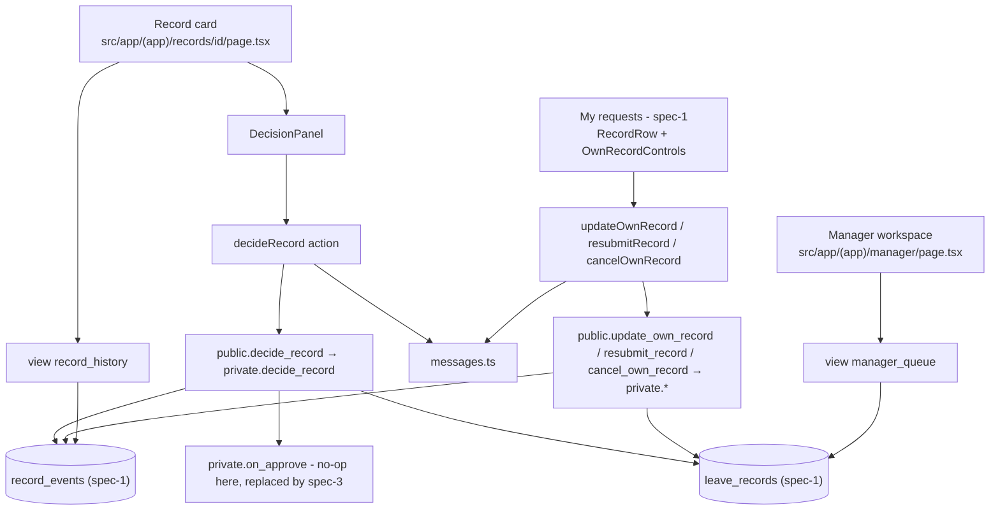
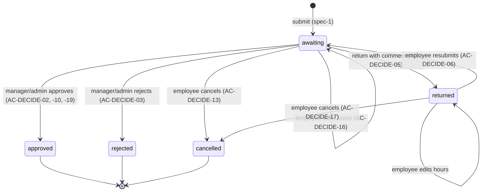
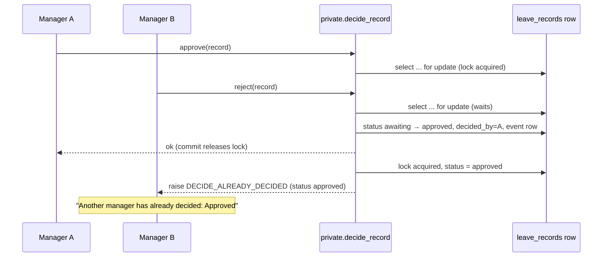

> Spec 2 of 3 — leave decision. Depends on: spec-1-leave-request. Used by: spec-3-leave-balance.

# Design Document

## Overview

This design implements the decision part of slice WS6 (`requirements.md`, Requirements 1–4, AC-DECIDE-01..19): the
manager workspace ("Awaiting decision" / "History"), the record card with its history and decision panel, the
`decide_record` database function, and the employee's edit / resubmit / cancel actions on their own records. It
targets the course's developer project template (`koldovsky/2026-quitcode-06-project-template`): Next.js 16 App
Router, React 19, Supabase (Postgres, Auth, RLS) via `@supabase/ssr`, Tailwind 4 and Vitest.

All rules that guard data (who may decide, which status may change to which, mandatory return comment, first decision
wins) are enforced in the database, so they hold for direct Data API calls too. The UI only mirrors them to hide
buttons that would be refused.

This spec adds no tables. It builds on spec-1's tables, select RLS, helper `private.is_manager_of(position_id)`, the
view `my_records`, the message map and the read-only "My requests" page, and it leaves a create-or-replace extension
point in `decide_record` for spec-3's balance check and split.

## Steering Document Alignment

### Technical Standards

Follows the template's `AGENTS.md` and first migration (`supabase/migrations/20261012000000_profiles_and_roles.sql`),
as already applied by spec-1:

- No new tables; no insert/update/delete grants to `authenticated` on leave tables — every write goes through a
  `security definer` function.
- `security definer` functions live only in schema `private`, with `set search_path = ''` and fully qualified names;
  `public` exposes thin `security invoker` wrappers that are the Data API surface (same pattern as spec-1's
  `submit_leave_request`).
- `auth.uid()` only as `(select auth.uid())`; role via the template's `private.current_app_role()`.
- Views use `with (security_invoker = true)`, so spec-1's RLS applies to every read.
- Migrations are timestamped `YYYYMMDDHHMMSS_name.sql`, newer than spec-1's (this spec uses `20261021090000`
  onward) — checked by `scripts/check-migration-order.mjs`.
- Every test title contains the AC ID it covers (`scripts/check-ac-coverage.mjs`); `docs/conformance.md` gets one row
  per AC-DECIDE ID.

### Project Structure

```
supabase/migrations/20261021090000_rpc_decide_record.sql      private.on_approve hook, decide_record
supabase/migrations/20261021090100_rpc_own_records.sql        update_own_record, resubmit_record, cancel_own_record
supabase/migrations/20261021090200_decision_views.sql         manager_queue, record_history
src/lib/leave/messages.ts                                     (spec-1 file) + DECIDE_* and RECORD_LOCKED codes
src/lib/leave/record-rules.ts                                 pure status rules shared by UI and tests
src/app/(app)/manager/page.tsx                                manager workspace (tabs)
src/app/(app)/records/[id]/                                   record card, decision panel, decideRecord action
src/app/(app)/requests/record-actions.ts                      updateOwnRecord, resubmitRecord, cancelOwnRecord
src/app/(app)/requests/OwnRecordControls.tsx                  edit / resubmit / cancel controls on My requests
tests/leave/  tests/db/  tests/e2e/                           unit, integration, end-to-end tests
```

## Code Reuse Analysis

### Existing Components to Leverage

- **spec-1 tables** `positions`, `position_managers`, `schedule_blocks`, `leave_types`, `leave_requests`,
  `leave_records` (incl. `status`, `manager_comment`, `decided_by`, `decided_at`), `record_events`: read and updated by
  this spec's functions; not redefined.
- **spec-1 select RLS** on those tables: employee sees own records, responsible manager sees records of managed
  positions, admin sees all. `manager_queue` and `record_history` inherit it through `security_invoker`.
- **`private.is_manager_of(position_id)`** (spec-1): the permission test in `decide_record` and in `manager_queue`.
- **`private.current_app_role()`** (template, roles extended by spec-1): detects `admin`.
- **spec-1 schedule helper `private.position_blocks(position_id, work_date)`** and the `leave_records` exclusion
  constraint: re-used by `update_own_record` to validate changed hours (AC-LEAVE-07..09) and catch overlaps (23P01 →
  `LEAVE_OVERLAP`, AC-LEAVE-13), with spec-1's error codes.
- **`src/lib/leave/messages.ts` `messageFor(code, params)`** (spec-1): extended with this spec's codes.
- **`src/lib/leave/schedule.ts`** (spec-1): `validateInterval` for instant feedback in the edit dialog.
- **view `my_records`** and **`src/app/(app)/requests/page.tsx`, `RecordRow.tsx`** (spec-1): the "My requests" list
  that this spec extends with the manager comment link and controls.
- **`src/lib/supabase/server.ts` `createClient()`** (template): every server action and server component.
- **`tests/db/helpers.ts`** (spec-1): sign in as demo users, reset data; **demo users and seed** (spec-1): teacher1,
  teacher2, manager1, manager2, admin `@example.test`.

### Integration Points

- **spec-1 "My requests"**: `RecordRow.tsx` renders `OwnRecordControls` and the manager comment; nothing else in the
  page changes.
- **spec-1 `record_events`**: this spec writes action values `approved`, `rejected`, `returned`, `edited`,
  `resubmitted`, `cancelled` (spec-1 writes `submitted`). `action` is free text in spec-1's model; if spec-1 adds a
  check constraint, it must list these values.
- **spec-3-leave-balance**: replaces `private.on_approve(...)` with `create or replace` to add the balance check, the
  `BALANCE_SPLIT_REQUIRED` refusal and the `paid_days`/`unpaid_days` snapshot; adds an optional `acceptSplit`
  argument to `decideRecord` and the split warning to the decision panel (see spec-3).
- **Supabase Auth**: `auth.uid()` is the actor in every function and history line.

## Architecture

Server components read through RLS-protected views; every write goes through a server action that calls one public
RPC wrapper, which calls one `security definer` function in `private`. Each function re-checks permissions explicitly
(because it bypasses RLS), locks the record with `select … for update`, validates the status transition, writes the
change and one `record_events` row in a single transaction, and raises a stable error code on refusal. Server actions
map codes to texts with `messageFor` and revalidate `/manager`, `/requests` and `/records/[id]`.

### Modular Design Principles

- **Single File Responsibility:** one migration per concern (decision, own-record actions, views); one actions file
  per screen; one pure rules module.
- **Component Isolation:** `DecisionPanel`, `RecordHistory`, `QueueTable`, `OwnRecordControls` and `EditRecordDialog`
  receive data via props and call server actions.
- **Service Layer Separation:** UI → server action → public RPC → private function; pages never write tables.
- **Utility Modularity:** `record-rules.ts` (allowed actions per status, comment check) is imported by UI and tests;
  the SQL functions are the authority.



### Record status lifecycle (transitions owned by this spec)



### Concurrent decision sequence (AC-DECIDE-07)



## Components and Interfaces

### Component 1 — `decide_record` (`supabase/migrations/20261021090000_rpc_decide_record.sql`)

- **Purpose:** the only way to approve, reject or return a record (Requirements 2, 3; AC-DECIDE-02..05, -07..-10,
  -15, -18, -19).
- **Interfaces:**
  - `private.decide_record(p_record_id uuid, p_decision text, p_comment text default null, p_accept_split boolean default false) returns public.leave_records`
    — `security definer`, `set search_path = ''`.
  - `public.decide_record(p_record_id uuid, p_decision text, p_comment text default null, p_accept_split boolean default false)`
    — `security invoker` wrapper, `grant execute … to authenticated`.
  - `private.on_approve(p_record public.leave_records, p_accept_split boolean) returns void` — extension hook, a
    no-op in this spec.
- **Algorithm (in order):**
  1. `v_actor := (select auth.uid())`; if null → `DECIDE_FORBIDDEN`.
  2. `p_decision` must be `approve | reject | return`, else `DECIDE_INVALID`.
  3. `select * into v_rec from public.leave_records where id = p_record_id for update`; not found →
     `DECIDE_FORBIDDEN` (no existence leak).
  4. Permission: `v_is_admin := private.current_app_role() = 'admin'`. If not admin: if
     `v_rec.employee_id = v_actor` → `DECIDE_OWN_RECORD` when `private.is_manager_of(v_rec.position_id)`
     (AC-DECIDE-18), else `DECIDE_FORBIDDEN` (AC-DECIDE-09); if not `private.is_manager_of(v_rec.position_id)` →
     `DECIDE_FORBIDDEN` (AC-DECIDE-08). Admin passes for any record, including positions without managers (BR-4) and
     managers' own records (AC-DECIDE-19).
  5. Status: `cancelled` → `DECIDE_NOT_AWAITING`; any other status ≠ `awaiting` → `DECIDE_ALREADY_DECIDED` with
     `detail = status` (AC-DECIDE-07, BR-2).
  6. `return` with `nullif(btrim(p_comment), '') is null` → `DECIDE_COMMENT_REQUIRED` (AC-DECIDE-04).
  7. If `approve`: `perform private.on_approve(v_rec, p_accept_split)` — extension point, still under the row lock.
  8. `update leave_records set status = …, manager_comment = nullif(btrim(p_comment), ''), decided_by = v_actor,
     decided_at = date_trunc('minute', now())` (BR-7).
  9. `insert into record_events (record_id, actor_id, action, from_status, to_status, comment)` (AC-DECIDE-10, -15).
  10. Return the updated row.
- **Errors** are raised as `raise exception using errcode = 'P0001', message = '<CODE>', detail = '<param>'` so the
  server action reads `error.message` / `error.details`.
- **Extension design for spec-3:** PostgreSQL `create or replace function` cannot change a function's argument list,
  so the final signature is declared now with a trailing `p_accept_split boolean default false` that this spec does
  not use (callers in this spec pass three arguments). Balance logic belongs in `private.on_approve`, which spec-3
  replaces with `create or replace` in a later migration; if spec-3 must also change `decide_record`'s body, it is a
  plain `create or replace` with the same signature. Grants and generated types stay valid. A `drop` + `create` with
  a new argument was rejected: it drops grants and changes the generated RPC type.
- **Dependencies:** spec-1 tables and `private.is_manager_of`; template `private.current_app_role()`.
- **Reuses:** RPC wrapper pattern of spec-1's `submit_leave_request`.

### Component 2 — Employee record functions (`supabase/migrations/20261021090100_rpc_own_records.sql`)

- **Purpose:** edit, resubmit and cancel own records (Requirement 4; AC-DECIDE-06, -12, -13, -16, -17).
- **Interfaces** (each a `private` `security definer` function plus a `public` wrapper granted to `authenticated`):
  - `update_own_record(p_record_id uuid, p_start time, p_end time) returns public.leave_records` — new local
    (Europe/Kyiv) start/end on the record's own date; "whole day" is sent as the position's first block start and
    last block end.
  - `resubmit_record(p_record_id uuid) returns public.leave_records`.
  - `cancel_own_record(p_record_id uuid) returns public.leave_records`.
- **Shared steps:** lock the record `for update`; not found or `employee_id <> (select auth.uid())` →
  `RECORD_FORBIDDEN`; allowed statuses: update `awaiting | returned`, resubmit `returned`, cancel `awaiting | returned`;
  otherwise `RECORD_LOCKED` with `detail = status` (AC-DECIDE-12, -17, BR-1, BR-5).
- **`update_own_record`:** validates against `private.position_blocks(position_id, work_date)` with spec-1's rules
  and codes (`LEAVE_OUTSIDE_SCHEDULE`, `LEAVE_START_AT_BLOCK_END`, `LEAVE_END_BEFORE_START`); recomputes `start_at`,
  `end_at`, `minutes` (gap minutes excluded) the same way as spec-1; the exclusion constraint violation (23P01) is
  caught and re-raised as `LEAVE_OVERLAP`. Status is kept (AC-DECIDE-16; a returned record stays returned until
  resubmitted). Event `edited` with comment `"08:30–15:30 → 09:00–12:00"`.
- **`resubmit_record`:** `returned → awaiting`, clears `manager_comment`, `decided_by`, `decided_at` on the record (the
  return comment stays in history); event `resubmitted`. Because the queue is derived from `position_managers`, the
  record reaches the same managers (AC-DECIDE-06, BR-6). The UI's "Save and resubmit" calls `update_own_record` then
  `resubmit_record`.
- **`cancel_own_record`:** `awaiting | returned → cancelled`; event `cancelled`. The exclusion constraint already
  ignores cancelled records (spec-1), so the time becomes free.
- **Dependencies:** spec-1 tables, `private.position_blocks`, exclusion constraint.
- **Reuses:** spec-1 validation helper and error codes; no duplicated schedule logic.

### Component 3 — Read views (`supabase/migrations/20261021090200_decision_views.sql`)

- **Purpose:** role-filtered lists for the workspace and card (AC-DECIDE-01, -11, -14, -15).
- **Interfaces:**
  - `public.manager_queue` (`security_invoker = true`): `record_id, request_id, employee_id, employee_name,
    position_id, position_title, division_name, work_date, start_local, end_local, minutes, leave_type, leave_type_name,
    status, manager_comment, decided_by, decided_by_name, decided_at, last_changed_at, tab`
    where `tab = 'awaiting'` for status `awaiting` and `'history'` otherwise. Filter: admin sees all records of other
    employees and managers' own records; a manager sees records where `private.is_manager_of(position_id)` and
    `employee_id <> (select auth.uid())` (BR-3). Times rendered in Europe/Kyiv.
  - `public.record_history` (`security_invoker = true`): `record_id, event_id, at (to the minute, Europe/Kyiv),
    actor_id, actor_name, actor_role_label, action, from_status, to_status, comment`, ordered by `at, event_id`.
    Visibility = spec-1's `record_events` select RLS (employee, responsible managers, admin).
- **Grants:** `select` to `authenticated` only.
- **Dependencies:** spec-1 tables and RLS. The employee does not enter a comment in WS6 (spec-1 stores none), so the
  card shows no employee comment.

### Component 4 — Error codes (`src/lib/leave/messages.ts`, spec-1 file)

- **Purpose:** exact user-facing texts for this spec's codes.
- **Interfaces:** new codes in the existing `messageFor(code, params)`:

| Code | Message | AC |
|---|---|---|
| `DECIDE_COMMENT_REQUIRED` | Tell the employee what to fix | AC-DECIDE-04 |
| `DECIDE_ALREADY_DECIDED` | Another manager has already decided: {Status label} | AC-DECIDE-07 |
| `DECIDE_NOT_AWAITING` | This record is no longer awaiting decision: {Status label} | BR-2 |
| `DECIDE_OWN_RECORD` | Your own record is decided by an administrator | AC-DECIDE-18 |
| `DECIDE_FORBIDDEN` | You cannot decide on this record | AC-DECIDE-08, -09 |
| `DECIDE_INVALID` | Choose approve, reject or return for revision | input guard |
| `RECORD_LOCKED` | This record is already {status label, lower case} and cannot be changed | AC-DECIDE-12, -17 |
| `RECORD_FORBIDDEN` | You can change only your own records | BR-5 |

  Status labels come from one map (`awaiting` → "Awaiting decision", `approved` → "Approved", `rejected` →
  "Rejected", `returned` → "Returned for revision", `cancelled` → "Cancelled"), so `RECORD_LOCKED` for `approved`
  yields exactly "This record is already approved and cannot be changed".

### Component 5 — Pure record rules (`src/lib/leave/record-rules.ts`)

- **Purpose:** mirror the SQL rules for UI decisions without I/O.
- **Interfaces:** `allowedOwnActions(status): { edit: boolean; resubmit: boolean; cancel: boolean }`;
  `canBeDecided(status): boolean`; `validateDecisionInput(decision, comment): ErrorCode | null` (blank comment on
  return → `DECIDE_COMMENT_REQUIRED`).
- **Dependencies:** none. **Reuses:** status type from spec-1's generated `database.types.ts`.

### Component 6 — Server actions

- **`src/app/(app)/records/[id]/actions.ts` `decideRecord(recordId, decision, comment?)`** →
  `{ ok: true } | { ok: false, message, code }`; calls `rpc('decide_record', …)`, maps codes, revalidates
  `/manager` and `/records/[id]`; on `DECIDE_ALREADY_DECIDED` / `DECIDE_NOT_AWAITING` the card re-renders with the
  current status. Spec-3 adds an optional `acceptSplit` argument.
- **`src/app/(app)/requests/record-actions.ts` `updateOwnRecord(recordId, { start, end } | { wholeDay: true })`,
  `resubmitRecord(recordId)`, `cancelOwnRecord(recordId)`** → same result shape; revalidate `/requests` and
  `/manager`. Kept in a separate file from spec-1's `submitRequest` action to avoid editing spec-1's module.
- **Dependencies:** `createClient()`, `messageFor`. Input shape is checked (UUID, `HH:MM` on a 5-minute grid) before
  the RPC call.

### Component 7 — Manager workspace (`src/app/(app)/manager/page.tsx`, `QueueTable.tsx`)

- **Purpose:** "Awaiting decision" (default) and "History" tabs via `?tab=awaiting|history&page=n`; columns employee,
  position (division / title), date, hours, leave type, status (History also: decided by, decided at); row links to the
  record card; empty state "No records awaiting decision" (AC-DECIDE-14).
- **Access:** visible in navigation for `manager` and `admin`; for others the page shows no rows (RLS) and is hidden
  from navigation.

### Component 8 — Record card (`src/app/(app)/records/[id]/page.tsx`, `DecisionPanel.tsx`, `RecordHistory.tsx`)

- **Purpose:** record details, current status, manager comment, history lines "date time — who — action — comment"
  (AC-DECIDE-10, -15); `DecisionPanel` with Approve, Reject, Return for revision (comment textarea, required for
  return) shown only when the viewer may decide and the status is `awaiting`; the server is the authority, so a
  refused action shows its message (AC-DECIDE-04, -07, -18). Spec-3 adds the balance warning and split choice to the
  panel. The employee opens the same card from "My requests" (no panel). A record the viewer cannot see → `notFound()`.

### Component 9 — Own-record controls (`src/app/(app)/requests/OwnRecordControls.tsx`, `EditRecordDialog.tsx`)

- **Purpose:** on each "My requests" row: Edit hours (awaiting, returned), Save and resubmit (returned), Cancel record
  with confirmation (awaiting, returned), link "History"; the manager comment is shown under a returned / rejected
  record (AC-DECIDE-03, -05). Edit dialog: whole day / hours on a 5-minute grid within the record's schedule,
  instant validation with spec-1's `validateInterval`.
- **Reuses:** spec-1 `RecordRow.tsx` (one-line change to render the controls), `schedule.ts`.

## Data Models

No new tables. Columns this spec writes on spec-1's tables:

```
leave_records (spec-1)
- status:          text  awaiting → approved | rejected | returned | cancelled;  returned → awaiting | cancelled
- manager_comment: text null   set on decision (required for return); cleared on resubmit
- decided_by:      uuid null → profiles   actor of the last decision; cleared on resubmit
- decided_at:      timestamptz null       date_trunc('minute', now()); cleared on resubmit
- start_at, end_at, minutes               recomputed by update_own_record
- paid_days, unpaid_days                  NOT written here (spec-3)

record_events (spec-1) — one row per action
- record_id:   uuid → leave_records
- actor_id:    uuid → profiles
- action:      text  approved | rejected | returned | edited | resubmitted | cancelled
- from_status: text null
- to_status:   text
- comment:     text null  (manager comment, or "old hours → new hours" for edited)
- at:          timestamptz default now()
```

Read models:

```
manager_queue (view, security_invoker)
- record_id, request_id, employee_id, employee_name: uuid/uuid/uuid/text
- position_id, position_title, division_name: uuid/text/text
- work_date: date; start_local, end_local: time (Europe/Kyiv); minutes: int
- leave_type, leave_type_name: text
- status, manager_comment: text; decided_by: uuid null; decided_by_name: text null; decided_at: timestamptz null
- last_changed_at: timestamptz; tab: text ('awaiting' | 'history')

record_history (view, security_invoker)
- record_id: uuid; event_id: bigint; at: timestamptz
- actor_id: uuid; actor_name: text; actor_role_label: text ('Administrator' | 'Manager' | 'Employee')
- action, from_status, to_status, comment: text
```

TypeScript:

```
type Decision = 'approve' | 'reject' | 'return'
type ActionResult = { ok: true } | { ok: false; code: ErrorCode; message: string }
```

## Error Handling

1. **Return without comment** (AC-DECIDE-04)
   - **Handling:** `validateDecisionInput` blocks the submit in the panel; `decide_record` raises
     `DECIDE_COMMENT_REQUIRED` for direct calls.
   - **User Impact:** "Tell the employee what to fix" under the comment field; status unchanged.
2. **Concurrent decision** (AC-DECIDE-07)
   - **Handling:** row lock + status check; the second caller gets `DECIDE_ALREADY_DECIDED` with the current status;
     `DECIDE_NOT_AWAITING` if the employee cancelled meanwhile.
   - **User Impact:** "Another manager has already decided: Approved"; the card refreshes with the new status and
     history.
3. **Not a responsible manager / plain employee** (AC-DECIDE-08, -09)
   - **Handling:** `DECIDE_FORBIDDEN`; the record is also invisible through RLS, so the UI never offers the panel.
   - **User Impact:** nothing changes; a direct call gets the generic refusal with no record data.
4. **Manager's own record** (AC-DECIDE-18)
   - **Handling:** `DECIDE_OWN_RECORD`; the record is excluded from the manager's queue and the panel is hidden on the
     card.
   - **User Impact:** "Your own record is decided by an administrator".
5. **Changing a decided or cancelled record** (AC-DECIDE-12, -17)
   - **Handling:** `RECORD_LOCKED` with the status; controls hidden by `allowedOwnActions`.
   - **User Impact:** "This record is already approved and cannot be changed" (or "… cancelled …").
6. **Changed hours invalid or overlapping** (BR-5)
   - **Handling:** spec-1's codes from `update_own_record`; transaction rolled back.
   - **User Impact:** spec-1's message in the edit dialog; the record keeps its old hours.
7. **Another person's record** (BR-5)
   - **Handling:** `RECORD_FORBIDDEN`.
   - **User Impact:** "You can change only your own records"; nothing saved.
8. **Unknown error code or network failure**
   - **Handling:** server action logs the raw error and returns a generic message; nothing is assumed saved.
   - **User Impact:** "Something went wrong. Please try again."; the page re-reads the current state.

## Testing Strategy

### Unit Testing

Vitest in `tests/leave/`:

- `record-rules.test.ts` — `allowedOwnActions` for all 5 statuses (AC-DECIDE-12, -17), `validateDecisionInput`
  (AC-DECIDE-04).
- `messages.decide.test.ts` — every new code produces the exact AC text (AC-DECIDE-04, -07, -12, -18).

### Integration Testing

Vitest in `tests/db/` against local Supabase (`supabase start`), signing in as spec-1's demo users with the anon key
(never the service-role key for the actor under test), one `it()` per AC titled with its ID:

- `decide.test.ts` — AC-DECIDE-02, -03, -04, -05, -07 (two clients, second call after the first commits), -08, -09,
  -10, -18, -19; BR-2 (deciding a cancelled record).
- `own-records.test.ts` — AC-DECIDE-06, -12, -13, -16, -17; overlap and schedule refusals on edit; `RECORD_FORBIDDEN`.
- `decision-views.test.ts` — AC-DECIDE-01, -11, -14 (`manager_queue` per user), -15 (`record_history` for employee,
  both managers and admin; teacher2 sees nothing), BR-3 (manager's own record absent from their queue, present in
  admin's), BR-4 (position without manager in admin's queue).

### End-to-End Testing

Playwright (added by spec-1 if allowed in the course; otherwise these ACs are marked manually verified in
`docs/conformance.md`) in `tests/e2e/decision-flow.spec.ts`:

- manager1 opens "Awaiting decision", returns a record without comment → message (AC-DECIDE-04), with comment →
  teacher1 sees the comment (AC-DECIDE-05), edits hours and resubmits → back in manager1's list (AC-DECIDE-06);
- manager approves → record moves to "History", history line shows date/time, name, "Approved" (AC-DECIDE-11, -15);
- empty state for a manager with no records (AC-DECIDE-14).
