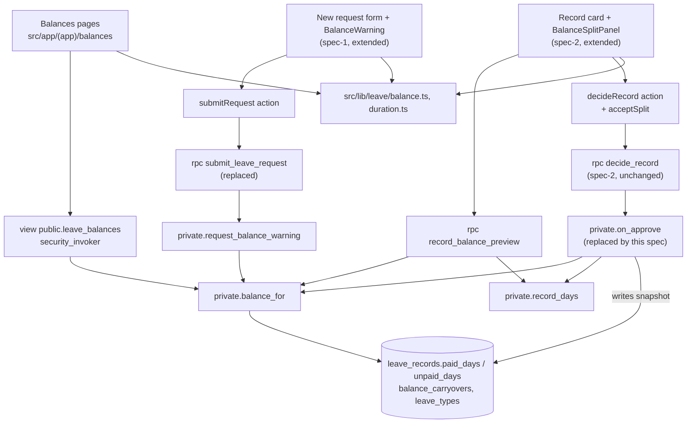
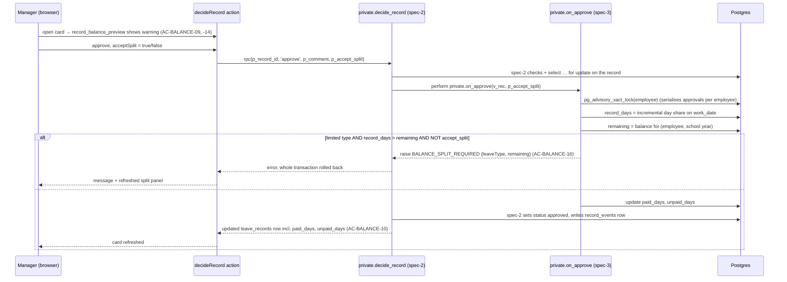

Spec 3 of 3 — leave balance. Depends on: spec-1-leave-request, spec-2-leave-decision. Used by: none.

# Design Document

## Overview

This design implements the leave-balance part of slice WS6 (`requirements.md`, Requirements 1–3, AC-BALANCE-01..16).
It targets the course's developer project template (`koldovsky/2026-quitcode-06-project-template`): Next.js 16 App
Router, React 19, Supabase (Postgres, Auth, RLS) via `@supabase/ssr`, Tailwind 4 and Vitest.

The balance is never stored as a running number. It is derived from approved leave records: when a manager approves a
record, spec-2's `decide_record` calls the hook `private.on_approve` (replaced by this spec), which fixes how many days of it are paid (counted under its own leave type) and how many are unpaid
(counted as Unpaid leave) in a snapshot on the record (`paid_days`, `unpaid_days`). The view `leave_balances` sums those
snapshots per employee, leave type and school year and adds the granted days and the carry-over. Every rule that
guards data (who may see balances, the split being mandatory, consistency under concurrent approvals) is enforced in
the database so it holds for direct API calls. The same arithmetic (day share, school year, split) also exists as pure
TypeScript functions used for display and checked against SQL by a shared test matrix.

What already exists and is only referenced here:

- **from spec-1-leave-request:** tables `leave_types` (`code`, `name`, `is_paid`, `sort_order` — this spec adds
  `annual_limit`), `leave_requests` (holds `leave_type`), `leave_records` (incl. `work_date`, `minutes`,
  `day_total_minutes` > 0, `status`), `record_events`, `positions` (incl. `active_from`), `position_managers`,
  `schedule_blocks`, `app_settings` (`time_zone`) with their select RLS; helpers `private.is_manager_of(p_position_id)`,
  `private.is_admin()`, `private.position_blocks(position_id, date)`; demo users and `scripts/seed-leave-demo.mjs`;
  `src/lib/leave/messages.ts` (`messageFor`, `parseRpcError`); RPC `submit_leave_request(payload jsonb) returns jsonb`
  (`{request_id, record_ids}`); the New request page (`RequestForm`) and `submitRequest` action; `tests/db/helpers.ts`;
  Playwright config. Migrations up to `20261020090400`.
- **from spec-2-leave-decision:** RPC `decide_record(p_record_id, p_decision, p_comment, p_accept_split boolean
  default false) returns public.leave_records`, which calls the no-op hook
  `private.on_approve(p_record public.leave_records, p_accept_split boolean) returns void` while the record row is
  locked and before the status update; the record card `src/app/(app)/records/[id]/` (`page.tsx`, `DecisionPanel.tsx`)
  and `decideRecord(recordId, decision, comment?)` in `actions.ts`; the manager workspace. Migrations
  `20261021090000`–`20261021090200`.

## Steering Document Alignment

### Technical Standards

Follows the template's `AGENTS.md` and its first migration (`supabase/migrations/20261012000000_profiles_and_roles.sql`),
the same conventions spec-1 and spec-2 use:

- RLS enabled on every new `public` table; `revoke all from anon, authenticated`, then explicit grants per operation.
- One policy per operation, always `to authenticated`; `auth.uid()` only as `(select auth.uid())`.
- `security definer` functions only in schema `private`, with `set search_path = ''`; callable through thin
  `security invoker` wrappers in `public` granted to `authenticated`.
- Views over protected tables use `with (security_invoker = true)`; no security-definer views.
- Migrations are timestamped `YYYYMMDDHHMMSS_name.sql`, starting at `20261022090000`, newer than every spec-1 and
  spec-2 migration (`scripts/check-migration-order.mjs`).
- Error codes are raised as spec-1 and spec-2 do (`raise exception using errcode = 'P0001', message = '<CODE>', detail
  = '<json params>'`) and turned into text only by `src/lib/leave/messages.ts` (`parseRpcError` + `messageFor`).
- spec-2's `decide_record` signature is not changed: balance logic lives only in `private.on_approve`.
- Every test title contains the AC ID it covers (`scripts/check-ac-coverage.mjs`); `docs/conformance.md` gets one row
  per AC-BALANCE ID.

### Project Structure

```
supabase/migrations/2026102209xxxx_*.sql   annual_limit, balance schema, functions, view, replaced
                                           submit_leave_request and private.on_approve (this spec)
scripts/seed-leave-demo.mjs                + demo carry-over rows (spec-1 file, extended)
src/lib/leave/duration.ts                  dayShare, incrementalDayShare, formatDays (new)
src/lib/leave/balance.ts                   schoolYearOf, schoolYearLabel, suggestSplit (new)
src/lib/leave/messages.ts                  + BALANCE_* codes (spec-1 file, extended)
src/app/(app)/balances/                    Balances pages (new)
src/app/(app)/records/[id]/                + BalanceSplitPanel, acceptSplit in action (spec-2 files, extended)
src/app/(app)/requests/                    + BalanceWarning after submit (spec-1 files, extended)
tests/leave/                               unit tests for pure functions
tests/db/                                  integration tests against local Supabase
tests/e2e/                                 browser flow (spec-1's Playwright config)
```

## Code Reuse Analysis

### Existing Components to Leverage

- **`leave_types` (spec-1):** extended by this spec with `annual_limit` (sick/personal 18.00, unpaid/family null),
  which becomes the single source of "granted" days and of which types are limited; no other code hard-codes 18.00.
- **`leave_records.minutes` and `day_total_minutes` (spec-1):** the record's minutes inside the schedule and the
  employee's scheduled minutes on that date across all positions — exactly the numerator and denominator of the
  day-share rule (AC-BALANCE-03, -06).
- **`private.is_manager_of(p_position_id)` and `private.is_admin()` (spec-1):** reused by `private.can_see_employee`
  for the visibility rule (AC-BALANCE-12, -13).
- **`submit_leave_request` (spec-1):** same signature and return type (`jsonb`); body kept unchanged except that the
  result gains a `warning` key from `private.request_balance_warning` (AC-BALANCE-08, -15), as spec-1 anticipates.
- **`decide_record` and the `private.on_approve` hook (spec-2):** `decide_record` is not touched; this spec
  `create or replace`s only `private.on_approve` with the balance step (AC-BALANCE-09, -10, -14, -16). spec-2 already
  exposes `p_accept_split`, so grants and generated RPC types stay valid.
- **`messageFor(code, params)` in `src/lib/leave/messages.ts` (spec-1):** extended with the balance codes so all texts
  come from one map.
- **`src/lib/supabase/server.ts` `createClient()` (template):** every page and action reads through RLS with the user's
  JWT.
- **`tests/db/helpers.ts` and `playwright.config.ts` (spec-1):** sign-in as demo users, data reset, browser tests.
- **`scripts/seed-leave-demo.mjs` (spec-1):** resolves demo users by email; extended with carry-over rows.
- **`database.types.ts` (`npm run db:types`):** regenerated for the new view, columns and RPC signatures.

### Integration Points

- **Supabase Auth:** `auth.uid()` identifies the viewer in `private.can_see_employee` and the actor in RPCs.
- **Postgres (spec-1 schema):** new column `leave_types.annual_limit`; `balance_carryovers` references `profiles`
  and `leave_types`; new nullable columns on `leave_records`; the view joins `positions`, `leave_types`,
  `leave_records`, `leave_requests`.
- **spec-1 New request form:** the `submitRequest` server action passes the new `warning` field to the form.
- **spec-2 record card:** the card page loads `record_balance_preview(record_id)`; the `decideRecord` action gains the
  optional `acceptSplit` argument spec-2 reserved, passed as `p_accept_split`.

## Architecture

Reads go through the `security_invoker` view `leave_balances` and the preview RPC; the only write this spec adds is the
`paid_days`/`unpaid_days` snapshot written by `private.on_approve` inside spec-2's `decide_record` transaction. Day shares are always computed per date for the
whole employee (all positions, all leave types), so one date never exceeds 1.00 day.

### Modular Design Principles

- **Single File Responsibility:** `duration.ts` (day arithmetic), `balance.ts` (school year and split),
  `BalanceTable.tsx` (display), `BalanceSplitPanel.tsx` (manager warning), `BalanceWarning.tsx` (employee warning);
  one migration per concern.
- **Component Isolation:** presentational components receive already-computed numbers via props; none queries the
  database.
- **Service Layer Separation:** UI → server action / server component → view or RPC; SQL owns the authoritative
  numbers, TypeScript only formats and mirrors them.
- **Utility Modularity:** pure functions have no imports beyond each other and are tested on their own.



### Approval with balance check



## Components and Interfaces

### Component 1 — Day arithmetic (`src/lib/leave/duration.ts`; SQL `private.day_share`)

- **Purpose:** day share of minutes, rounded half up to 2 dp, capped at 1.00; incremental share of a date; display
  format.
- **Interfaces:**
  - `dayShareHundredths(minutes: number, dayTotalMinutes: number): number` — integer hundredths,
    `min(100, floor((200 * minutes + total) / (2 * total)))`; throws when `dayTotalMinutes <= 0`.
  - `dayShare(minutes, dayTotalMinutes): number` — hundredths / 100 (AC-BALANCE-03: 150/420 → 0.36; AC-BALANCE-06:
    75/495 → 0.15).
  - `incrementalDayShare(approvedMinutes, addedMinutes, dayTotalMinutes): number` —
    `dayShare(approved + added) − dayShare(approved)` (AC-BALANCE-05: 0.85 then 0.15 → 1.00).
  - `formatDays(days: number): string` — always 2 decimals ("0.50").
- **Dependencies:** none (pure).
- **Reuses:** nothing existing; SQL twin `private.day_share(minutes int, total int) returns numeric(5,2)` uses
  `least(1.00, round(minutes::numeric / total, 2))` (Postgres `round` on numeric rounds half away from zero, i.e. half up
  for positive values).

### Component 2 — School year and split (`src/lib/leave/balance.ts`; SQL `private.school_year_of`)

- **Purpose:** map a date to its school year; label it; split requested days into paid and unpaid.
- **Interfaces:**
  - `schoolYearOf(isoDate: string): number` — the calendar year in which the school year starts; 1 Sep–31 Aug
    (`2027-08-31` → 2026, `2027-09-01` → 2027, AC-BALANCE-11).
  - `schoolYearLabel(year: number): string` — `"2026–2027"`.
  - `suggestSplit(requestedDays: number, remainingDays: number): { paid: number; unpaid: number; exceeded: boolean }`
    computed in hundredths: `paid = min(requested, max(remaining, 0))`, `unpaid = requested − paid`
    (AC-BALANCE-08: 1.00 vs 0.50 → 0.50 + 0.50; AC-BALANCE-15: 0.36 vs 0.20 → 0.20 + 0.16).
- **Dependencies:** none (pure).
- **Reuses:** nothing existing; SQL twin `private.school_year_of(d date) returns int` =
  `extract(year from d - interval '8 months')::int`.

### Component 3 — Balance messages (`src/lib/leave/messages.ts`, extended)

- **Purpose:** exact AC texts for the balance warnings and the refusal.
- **Interfaces:** new codes for `messageFor(code, params)`:
  - `BALANCE_WARNING_SUBMIT {leaveType, remaining, unpaid}` → "Your {leaveType} balance is {remaining} day. Another
    {unpaid} day will be counted as Unpaid leave" (AC-BALANCE-08, -15).
  - `BALANCE_WARNING_DECIDE {leaveType, remaining, paid, unpaid}` → "This request exceeds the {leaveType} balance
    ({remaining} day). Suggested: {paid} day {leaveType}, {unpaid} day Unpaid leave" (AC-BALANCE-09, -14).
  - `BALANCE_SPLIT_REQUIRED {leaveType, remaining}` → "The {leaveType} balance is {remaining} day: approve with the
    suggested split or reject" (AC-BALANCE-16).
  - Numbers are formatted with `formatDays`; `leaveType` is the leave type's display name ("Personal leave").
- **Dependencies:** Component 1 (`formatDays`).
- **Reuses:** spec-1's `messageFor` map and its unknown-code fallback.

### Component 4 — Visibility and balance functions (SQL, `private` schema)

- **Purpose:** authoritative balance numbers and who may see them.
- **Interfaces:**
  - `private.can_see_employee(p_employee uuid) returns boolean` (security definer, stable) — true if
    `p_employee = (select auth.uid())`, or `private.is_admin()`, or the caller is a responsible manager of any
    position of `p_employee` (via `private.is_manager_of`) (AC-BALANCE-12, -13).
  - `private.first_school_year(p_employee uuid) returns int` — the earliest of the employee's carry-over years and the
    school year of their earliest position `active_from`, never earlier than 2026 (first school year of the portal).
  - `private.record_days(p_record uuid) returns numeric(5,2)` — incremental share of the record on its `work_date`:
    `day_share(A + r.minutes, r.day_total_minutes) − day_share(A, r.day_total_minutes)`, where `A` is the sum of
    `minutes` of the employee's other approved records on that date (all positions, all types).
  - `private.balance_for(p_employee uuid, p_school_year int) returns table (leave_type text, leave_type_name text,
    granted numeric, carried_over numeric, used numeric, remaining numeric)` (security definer) — returns no rows unless
    `private.can_see_employee(p_employee)`. Rules:
    - limited type T: `used = Σ paid_days` of approved records of type T in the year;
      `carried_over(Y) = balance_carryovers(Y)` if a row exists, else `remaining(Y−1)` for `Y > first_school_year`,
      else 0; `remaining = granted + carried_over − used`;
    - `unpaid`: `used = Σ unpaid_days` of all approved records in the year (Unpaid leave records and split parts);
      granted, carried_over, remaining are null;
    - other unlimited types (`family`): `used = Σ paid_days` of approved records of that type; others null.
  - `private.request_balance_warning(p_request uuid) returns jsonb` — for a limited leave type: per school year,
    requested days = Σ over dates of `incremental share(approved minutes on the date, request's minutes on the date)`;
    returns `null` when no year is exceeded, otherwise `{leaveType, leaveTypeName, items: [{schoolYear, remaining,
    paid, unpaid}]}` with one item per exceeded school year (normally one).
  - `private.record_balance_preview(p_record uuid) returns jsonb` (security definer) — null unless the caller
    `can_see_employee` of the record's employee, the record is "Awaiting decision" and its type is limited; otherwise
    `{leaveType, leaveTypeName, recordDays, remaining, exceeded, paid, unpaid}`. Public wrapper
    `public.record_balance_preview(record_id uuid)`.
- **Dependencies:** spec-1 tables and helpers.
- **Reuses:** `private.is_manager_of`, `private.is_admin`.

### Component 5 — View `public.leave_balances`

- **Purpose:** one row per visible employee, school year and leave type for the Balances pages (AC-BALANCE-01..07,
  -10, -11).
- **Interfaces:** `leave_balances(employee_id, school_year, leave_type, leave_type_name, granted, carried_over, used,
  remaining)`, `with (security_invoker = true)`. Driver rows are `select distinct employee_id from public.positions`
  (spec-1's RLS already limits these to self / own positions' employees / all for admin), crossed with school years
  from `private.first_school_year(employee)` to the current school year + 1 (Kyiv date; the next year is included so
  requests for September can be checked), joined laterally with `private.balance_for`.
- **Dependencies:** Component 4.
- **Reuses:** spec-1 `positions` RLS for row visibility; `private.balance_for` re-checks visibility because aggregates
  need records the viewer cannot read (AC-BALANCE-06: the additional position's manager must still see the correct
  used value).

### Component 6 — `submit_leave_request` (replaced) and employee warning

- **Purpose:** return the over-balance warning when the request is created (AC-BALANCE-08, -15).
- **Interfaces:** `create or replace private.submit_leave_request(payload jsonb) returns jsonb` with spec-1's
  signature, return type and grants (the public wrapper is untouched); the result becomes
  `{request_id, record_ids, warning}` where `warning` is `private.request_balance_warning(request_id)` (null when not
  exceeded). `submitRequest` returns `{ ok: true, requestId, warnings: string[] }` (one text per item, empty when
  none); `RequestForm` shows `BalanceWarning` on its success state with a link to "My requests" instead of redirecting
  immediately when `warnings` is non-empty.
- **Dependencies:** Component 4; spec-1 action and form.
- **Reuses:** spec-1's function body unchanged (the warning is computed after the records are inserted, inside the same
  transaction; a warning never blocks submission).

### Component 7 — `private.on_approve` (replaced) and manager split panel

- **Purpose:** recompute the balance at decision time, require the split when exceeded, store the snapshot
  (AC-BALANCE-09, -10, -14, -16); show the warning on the card.
- **Interfaces:**
  - `create or replace function private.on_approve(p_record public.leave_records, p_accept_split boolean) returns
    void` — same signature as spec-2's no-op, `security definer`, `set search_path = ''`. spec-2's `decide_record`
    calls it only for `approve`, after its permission and status checks and under the record's row lock, before it
    sets the status; it then returns the updated row, so the caller sees `paid_days` / `unpaid_days`.
  - Hook body: `pg_advisory_xact_lock(hashtextextended('balance:' || p_record.employee_id, 0))`;
    `d = private.record_days(p_record.id)`; for a limited type `r = remaining(school_year_of(work_date))`;
    if `d > r` and not `accept_split` → raise `BALANCE_SPLIT_REQUIRED {leaveType, remaining: r}`; else
    `paid_days = least(d, r)`, `unpaid_days = d − paid_days`. Type `unpaid` → `paid_days = 0, unpaid_days = d`; other
    unlimited types → `paid_days = d, unpaid_days = 0`; then `update leave_records set paid_days, unpaid_days where id =
    p_record.id`. `p_accept_split` is ignored when the balance is not exceeded. The leave type is read from the
    record's `leave_requests` row.
  - Reject / return: unchanged from spec-2; `paid_days` / `unpaid_days` stay null (AC-BALANCE-07).
  - `decideRecord(recordId, decision, comment?, acceptSplit = false)` server action passes `p_accept_split`.
  - `BalanceSplitPanel({ preview })`: when `preview.exceeded` shows `BALANCE_WARNING_DECIDE` and the Approve button of
    `DecisionPanel` becomes "Approve with split" (sends `acceptSplit: true`); a "View balances" link opens
    `/balances/[employeeId]`.
- **Dependencies:** Components 3, 4; spec-2 action, card page and `DecisionPanel`.
- **Reuses:** spec-2's `decide_record` unchanged (permission checks, `for update` lock, status rules, `record_events`
  row, grants); spec-2's hook signature.

### Component 8 — Balances pages (`src/app/(app)/balances/`)

- **Purpose:** show granted, carried over, used and remaining per type and school year (Requirement 1) only to
  allowed viewers (Requirement 3).
- **Interfaces:** `/balances` (own, `employee_id = auth user`), `/balances/[employeeId]` (another employee; reached
  from the record card); optional `?year=2027` (a number only). Server components select from `leave_balances` and
  render `BalanceTable({ rows, year })`; the default year is `schoolYearOf(today in Europe/Kyiv)`. Limited types show
  four columns; unlimited types show "used" only. Zero rows → the neutral state "Balances are not available", identical
  for forbidden and unknown employees.
- **Dependencies:** Components 1, 2, 5; template server client.
- **Reuses:** spec-1's app layout and navigation (a "Balances" link is added).

## Data Models

### balance_carryovers (new)

```
- employee_id: uuid → public.profiles(id)
- leave_type: text → public.leave_types(code), check (leave_type in ('sick', 'personal'))
- school_year: int, check (school_year between 2026 and 2100)   -- year the school year starts
- days: numeric(5,2), check (days >= 0)
- PK (employee_id, leave_type, school_year)
RLS: select to authenticated using (private.can_see_employee(employee_id)); no insert/update/delete grants
(demo data via scripts/seed-leave-demo.mjs; administration UI is WS10).
```

### leave_types (spec-1 table, new column)

```
- annual_limit: numeric(5,2) null, check (annual_limit is null or annual_limit >= 0)
  -- set by this migration: sick 18.00, personal 18.00, unpaid null, family null
Readable by any authenticated user through spec-1's existing select policy (column grant added if spec-1 uses
column-level grants).
```

### leave_records (spec-1 table, new columns)

```
- paid_days: numeric(5,2) null     -- days counted under the record's own leave type (0 for Unpaid leave)
- unpaid_days: numeric(5,2) null   -- days counted as Unpaid leave (split part or an Unpaid leave record)
- check ((paid_days is null) = (unpaid_days is null))
- check (paid_days is null or (paid_days >= 0 and unpaid_days >= 0 and paid_days + unpaid_days <= 1.00))
Written only by private.on_approve during approval; null for every other status. Readable with the same RLS as the record
(column grant added if spec-1 uses column-level grants). Existing approved rows in dev data are backfilled by the
migration with private.record_days in work_date / decided_at order.
```

### leave_balances (view)

```
- employee_id: uuid
- school_year: int
- leave_type: text, leave_type_name: text
- granted: numeric(5,2) null        -- leave_types.annual_limit
- carried_over: numeric(6,2) null
- used: numeric(6,2)
- remaining: numeric(6,2) null      -- granted + carried_over − used
```

### Day-share rule

For an approved record on date D, its days are `day_share(A + m, T) − day_share(A, T)`, where `m` is the record's
minutes, `T` its `day_total_minutes` and `A` the minutes of the employee's other approved records on D across all
positions and types. Summed over a date this telescopes to `day_share(all approved minutes on D, T)`, so a date is the
rounded share of its minutes and never more than 1.00 (AC-BALANCE-05: 0.85 + 0.15 = 1.00). When two types share one
date, the 0.01 rounding difference falls on the record approved second; the date total is unaffected.

## Error Handling

1. **Balance exceeded, approve without split** (AC-BALANCE-16)
   - **Handling:** `private.on_approve` raises `BALANCE_SPLIT_REQUIRED` with `{leaveType, remaining}`; spec-2's
     `decide_record` transaction rolls back, the record stays "Awaiting decision".
   - **User Impact:** "The Personal leave balance is 0.50 day: approve with the suggested split or reject"; the split
     panel is refreshed.
2. **Balance changed between opening and deciding** (AC-BALANCE-14)
   - **Handling:** the hook recomputes remaining under the per-employee lock; without `p_accept_split` it raises as in
     1; with `p_accept_split` it applies the split computed at that moment and the returned row carries the stored
     values.
   - **User Impact:** the card shows the current warning or the actually stored split after refresh.
3. **Concurrent approvals for one employee**
   - **Handling:** `pg_advisory_xact_lock` per employee serialises the balance step; the second approval sees the
     first one's snapshot.
   - **User Impact:** paid days never exceed the balance; the second manager may get the split message.
4. **Viewer not allowed to see the employee** (AC-BALANCE-12, -13)
   - **Handling:** `leave_balances` returns no rows (driver rows and `balance_for` both filtered);
     `record_balance_preview` returns null.
   - **User Impact:** "Balances are not available" — the same as for an unknown employee.
5. **Request spanning two school years**
   - **Handling:** `request_balance_warning` checks each school year separately and returns one item per exceeded
     year.
   - **User Impact:** one warning line per affected school year; the request is still created.
6. **Approving a record that is not awaiting, or without permission**
   - **Handling:** spec-2's checks run before the hook, so `private.on_approve` is never reached; spec-2's codes apply.
   - **User Impact:** spec-2's messages; no balance change. (`day_total_minutes > 0` is guaranteed by spec-1's check,
     so a zero denominator cannot occur.)
7. **Preview unavailable** (record no longer awaiting, unlimited type)
   - **Handling:** `record_balance_preview` returns null.
   - **User Impact:** no warning panel; the decision buttons work as in spec-2.

## Testing Strategy

### Unit Testing

Vitest in `tests/leave/`, titles carry AC IDs:

- `duration.test.ts`: AC-BALANCE-03 (150/420 → 0.36), AC-BALANCE-06 (75/495 → 0.15), AC-BALANCE-05 (0.85 + 0.15 = 1.00),
  rounding 0.355 → 0.36, cap at 1.00, `formatDays`.
- `balance.test.ts`: AC-BALANCE-11 (`schoolYearOf` on 2027-08-31 / 2027-09-01, carry-over arithmetic), AC-BALANCE-08 and
  -15 (`suggestSplit`), no split when not exceeded, remaining 0.
- `messages-balance.test.ts`: exact texts for AC-BALANCE-08, -09, -14, -15, -16.

### Integration Testing

Vitest in `tests/db/` against local Supabase, signing in as demo users with spec-1's helpers; fixture setup (approved
history, carry-over) uses the service role, the actor under test never does:

- `balances.test.ts`: AC-BALANCE-01, -02, -03, -04, -05, -06, -07, -11 through `leave_balances`.
- `balance-split.test.ts`: AC-BALANCE-08, -15 (`submit_leave_request` result), AC-BALANCE-09, -14
  (`record_balance_preview`), AC-BALANCE-10, -16 (`decide_record` → `private.on_approve`), plus two parallel approvals never exceeding the
  balance.
- `balance-rls.test.ts`: AC-BALANCE-12, -13 for the view, `balance_carryovers` and the preview RPC.
- `balance-parity.test.ts`: a matrix of (minutes, total, remaining) evaluated by SQL functions and the TS functions
  gives identical results.

### End-to-End Testing

With spec-1's Playwright config, `tests/e2e/balance-flow.spec.ts` covers one flow: employee with 0.50 Personal leave
submits a whole day and sees the AC-BALANCE-08 warning → manager opens the record (AC-BALANCE-09) → approve without
split is refused (AC-BALANCE-16) → approve with split → Balances page shows AC-BALANCE-10 values. If Playwright was not
allowed in the course (spec-1's fallback), these steps are recorded as manually verified in `docs/conformance.md`.
